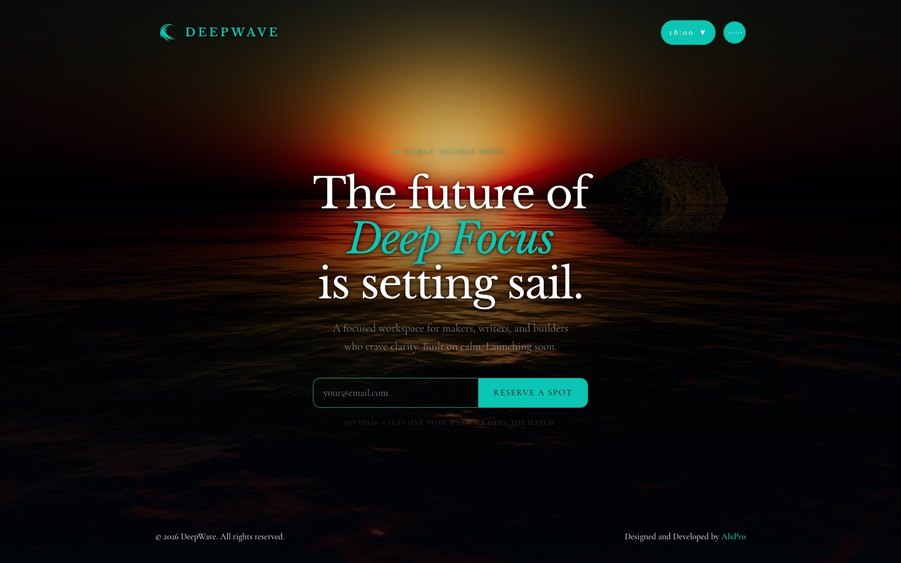

# DeepFocus | Concept landing page

[](https://github.com/al-xpro/deepfocus/actions/workflows/ci.yml)
[](https://github.com/al-xpro/deepfocus/releases)
[](LICENSE)
[](https://nextjs.org)
[](https://threejs.org)
[](https://r3f.docs.pmnd.rs)

> **Work in progress.** `v1.0` is the baseline built by hand in March 2026. What comes
> next is in the [milestones](https://github.com/al-xpro/deepfocus/milestones).

A landing page for **DeepFocus, a fictional focus app**, designed and developed by
[AlxPro](https://alxpro.com). It's a concept build: the product and its copy are invented
to show how 3D storytelling can carry a landing page. The page sits on a real-time ocean
whose sky, light and water follow the visitor's clock.

**Live:** [deepfocus.alxpro.com](https://deepfocus.alxpro.com)



<sub>The `v1.0` interface, before the redesign planned for `v1.1`.</sub>

## What it does

- A real-time 3D ocean: three.js water with reflections, a physically based sky, and an
  environment map that follows it
- Time of day from the visitor's clock: day, twilight and night blend the sky, light,
  water and exposure, and a time panel with a 24-hour scrubber sets any hour
- Glass controls in sync with the scene: white by day, black at dawn, dusk and night,
  tinted by the scene's light
- A night sky drawn from canvas textures, with no image downloads: about 3,700 stars,
  constellation lines, shooting stars, a moon and a sun glow
- Three dolphins with a behavior system: they steer around rocks and each other, rise to
  the surface, leap, and sometimes jump together in a pod
- Focus mode (`F`): the page steps aside for the scene, with 15, 30 or 60-minute focus
  sessions shown as a progress bar; they survive a reload and end with a soft bell
- The view turns slowly and endlessly; drag to look around
- A 404 page on the open sea at night, and an `llms.txt` for agents
- An ocean ambience (a CC0 field recording, self-hosted) that loads only when the
  visitor turns it on
- A waitlist that says it's a concept: the address dissolves into particles and nothing
  is sent
- No third-party requests: fonts, sound and the Draco decoder are self-hosted

## Tech stack

- [Next.js 16](https://nextjs.org) (App Router, statically prerendered) and React 19
- TypeScript and Tailwind CSS 4
- [React Three Fiber](https://r3f.docs.pmnd.rs), [drei](https://drei.docs.pmnd.rs) and
  [three.js](https://threejs.org): the `Sky` and `Water` objects, glTF models simplified
  and compressed with meshopt (`scripts/optimize-models.mjs`)
- Radix primitives for the panels, Framer Motion for the interface
- DM Sans, self-hosted through `next/font`

## Architecture

```text
app/                    layout, metadata, the one page
components/             the page, dock, glass panels, focus mode, sound, credits
components/scene/       the 3D scene
  OceanScene.tsx        sky, environment map, stars, constellations, comets, moon, sun
  Ocean.tsx             the water
  SceneEncounters.tsx   lights, coastal models, dolphins and their behavior
  sceneConfig.ts        day, twilight and night values for every scene parameter
  timeUtils.ts          sun position and the per-frame scene snapshot
  sceneParams.ts        the time override
  sceneTone.ts          publishes the scene's light to the page (the glass follows it)
public/models/          glTF models (see CREDITS.md)
```

**One clock drives the scene.** Every frame, the scene date (the real time, or the hour
picked in the time panel) becomes a snapshot: the sun's elevation, and three factors for
noon, twilight and night. Every value in `sceneConfig.ts` has a day, a twilight and a
night version, and the snapshot blends them, so the sky, lights, water, stars and
exposure always agree.

**The dolphins steer.** Each one picks targets through curved via-points, avoids the
rocks and the other dolphins, and moves through four phases: cruise, surface approach,
airborne, and dive. A dolphin about to leap can invite the others; those nearby join and
jump in sync.

## Getting started

Requires Node.js 20.9 or later (CI and production use 24).

```bash
npm install
npm run dev         # http://localhost:3000
npm run typecheck
npm run lint
npm run build
```

No environment variables yet.

## How this was built

I'm the developer on this project. The first version was built by hand, without AI coding
agents, from 22 to 31 March 2026, and published as [`v1.0`](https://github.com/al-xpro/deepfocus/releases/tag/v1.0)
in November 2026.

Since then it's developed in the open with AI coding agents
([Claude Code](https://claude.com/claude-code)), the way a lead works with a pair
programmer. I own the decisions, the specs and the code that ships:

1. **Decide.** Before a milestone, an agent interviews me about every open decision, one
   round at a time, until nothing is left assumed.
2. **Spec.** The decisions become an issue with context, a goal and acceptance criteria,
   split into small slices that each work end to end.
3. **Implement on a branch.** The draft passes typecheck, lint and the build before I see
   it.
4. **Review and change it locally.** I run it on desktop and phone, by day and by night,
   and change the code myself where it needs it. Nothing is pushed before I've used it.
5. **Pull request.** What, Why and How to test, linked to its issue. CI has to pass, and I
   merge.

Commits drafted with an agent carry a `Co-Authored-By` trailer, so the history is honest
about how the work was done. The [project board](https://github.com/users/al-xpro/projects/8)
shows the work in progress.

## Roadmap

- [`v1.1 — Interface`](https://github.com/al-xpro/deepfocus/milestone/1): a modern,
  minimalist interface, one focus style, real dialogs, focus sessions, licensed
  self-hosted sound
- [`v1.2 — Living ocean`](https://github.com/al-xpro/deepfocus/milestone/2): lighter
  models, ballistic dolphins with splashes, birds, fish, night bioluminescence
- [`v1.3 — Real sky`](https://github.com/al-xpro/deepfocus/milestone/3): the real sun,
  moon, seasons and weather for the visitor's place (clouds, fog, rain, storms), a
  soundscape that follows the weather, and any sky shared as a link or saved as a
  wallpaper
- [`v1.4 — Fast and findable`](https://github.com/al-xpro/deepfocus/milestone/4):
  a WebGPU renderer, measured speed, security headers, SEO, tests

## Contributing

Issues are welcome. See [CONTRIBUTING.md](CONTRIBUTING.md), the
[code of conduct](CODE_OF_CONDUCT.md) and the [security policy](SECURITY.md).

## Credits and license

The 3D models, textures and fonts come from other authors; each is listed with its license
in [CREDITS.md](CREDITS.md).

© AlxPro. All rights reserved. The code is public so it can be read and reviewed. It is not
licensed for reuse or redistribution. See [LICENSE](LICENSE).
